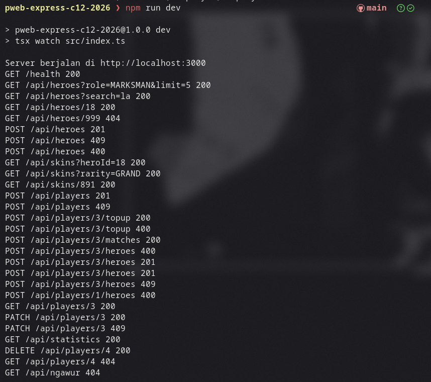
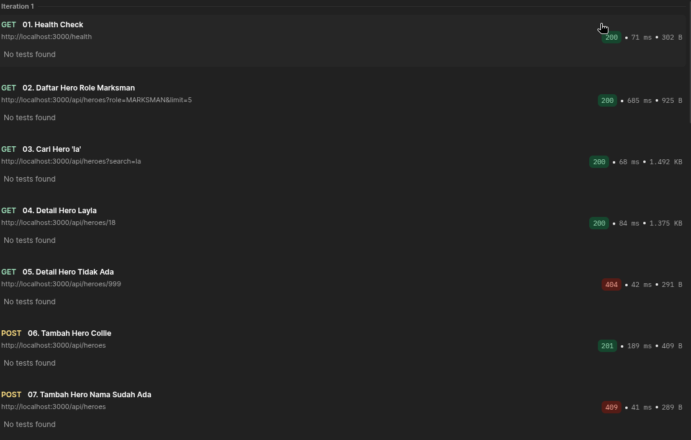
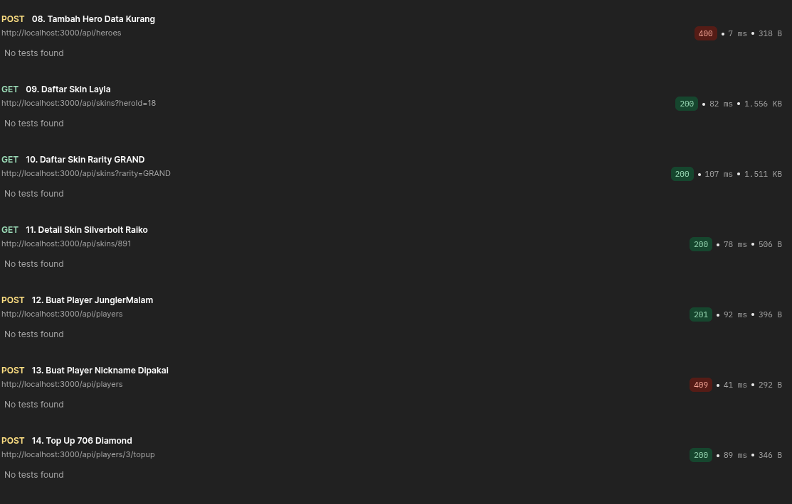
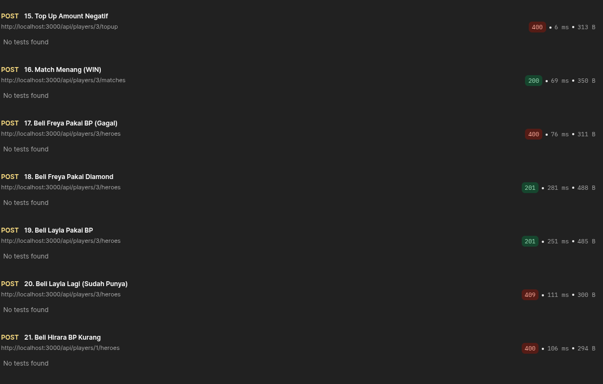
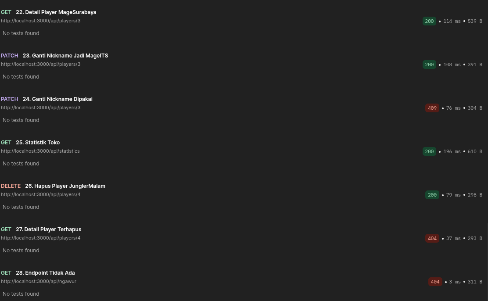

# MLBB Shop — Kelompok C12

Backend Express untuk toko Diamond & Battle Point Mobile Legends. Praktikum Pemrograman Web Modul 4.

## Identitas Kelompok

| Nama | NRP |
|---|---|
| Nabila Sharliz Sigit | 5027251054 |
| Catur Setyo Ragil | 5027251066 |
| Nabila Nafisatus Zuhro | 5027251073 |

## Tech Stack

- Express 5 + TypeScript
- Prisma ORM 7 + `@prisma/adapter-neon`
- PostgreSQL (Neon)

## How to Run

```bash
npm install
```

Isi `.env` (contoh di `.env.example`):

```env
PORT=3000
DATABASE_URL="postgresql://...-pooler...neon.tech/neondb?sslmode=require"
DIRECT_URL="postgresql://...neon.tech/neondb?sslmode=require"
```

```bash
npx prisma migrate dev --name init
npx tsx prisma/seed.ts
npm run dev
```

Cek `http://localhost:3000/health`. Jika environment memakai `NODE_ENV=production`, install dengan `npm install --include=dev`.

## Endpoint

| Metode | Endpoint | Keterangan |
|---|---|---|
| GET | `/health` | Health check |
| GET | `/api/heroes` | Daftar hero (`page`, `limit`, `search`, `role`) |
| GET | `/api/heroes/:hero_id` | Detail hero + skin |
| POST | `/api/heroes` | Tambah hero |
| GET | `/api/skins` | Daftar skin (`page`, `limit`, `heroId`, `rarity`) |
| GET | `/api/skins/:skin_id` | Detail skin + hero |
| POST | `/api/players` | Buat player |
| GET | `/api/players/:player_id` | Detail player + hero dimiliki |
| PATCH | `/api/players/:player_id` | Ubah nickname |
| DELETE | `/api/players/:player_id` | Hapus player |
| POST | `/api/players/:player_id/topup` | Top up Diamond |
| POST | `/api/players/:player_id/matches` | Catat hasil match |
| POST | `/api/players/:player_id/heroes` | Beli hero (BP/Diamond) |
| GET | `/api/statistics` | Statistik toko |

Response sukses: `{ status, message, data, metadata? }`. Response gagal: `{ status, message }`.

## Bukti Eksekusi

Server berjalan dan seluruh request tercatat di terminal:



Hasil pengujian Postman (Collection Runner, testcase 01–28):









## Pengujian

1. `npx tsx prisma/seed.ts` untuk mengembalikan data awal.
2. Import `mlbb-shop-testcase.postman_collection.json` ke Postman.
3. Jalankan Collection Runner sesuai urutan testcase (state saling bergantung).
4. Seed ulang sebelum demo.
